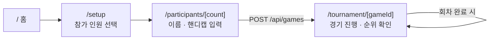
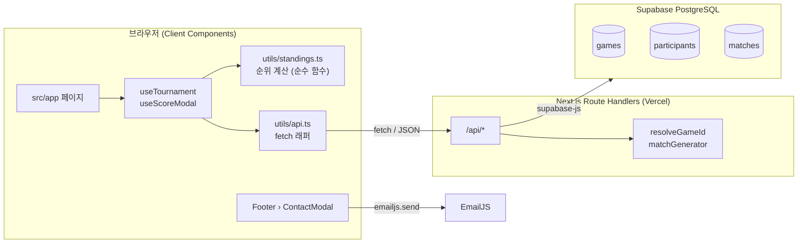
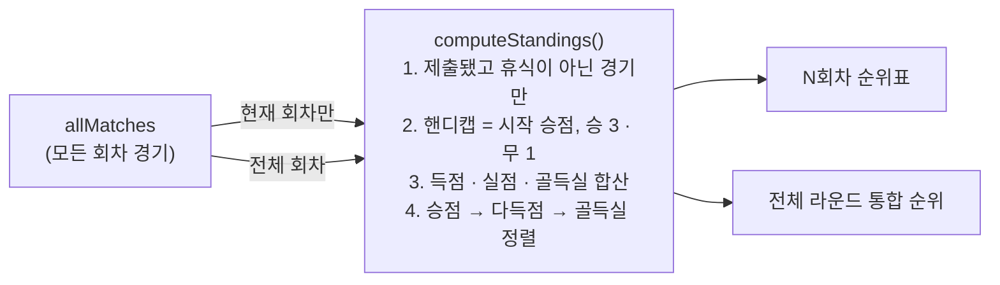
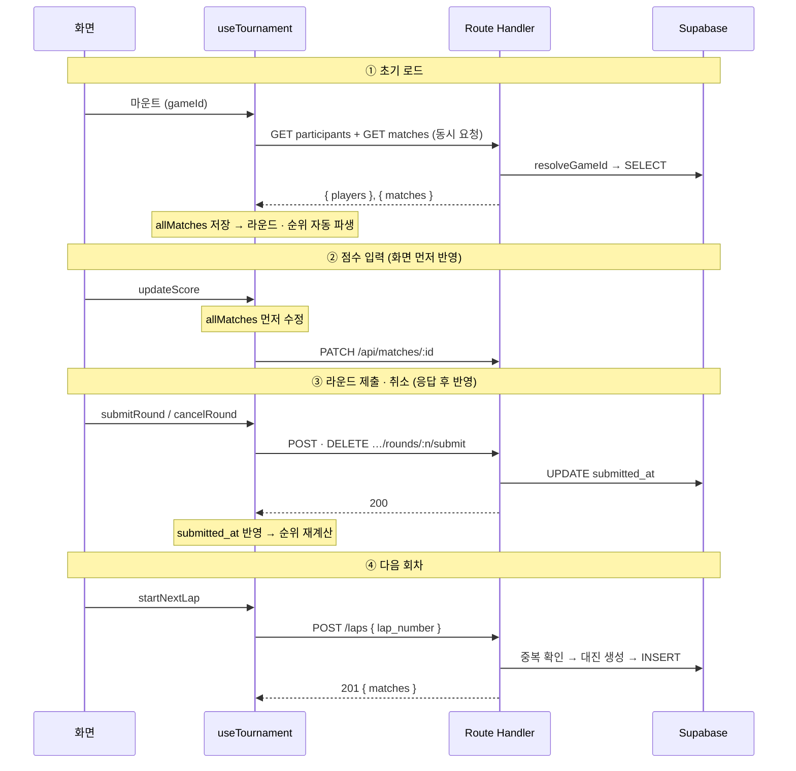

# 🏆 MatchUp - FC ONLINE 토너먼트 매니저

### 친구들과 FC ONLINE 내기를 더 편하게 진행할 수 있도록 돕는 리그전 토너먼트 웹 서비스

🔗 **서비스 주소**: [www.match-up.kr](https://www.match-up.kr)

인원과 핸디캡만 입력하면 라운드 로빈 대진표가 자동으로 만들어지고, 경기 점수를 입력하면 승점과 순위가 바로 계산됩니다. 지금도 친구들과 모일 때마다 직접 사용하면서 개선하고 있습니다.

<br/>

## 📌 기획 배경

예전에는 FC ONLINE 내기를 할 때 엑셀에 참가자를 직접 입력하고, 대진을 짜고, 점수를 기록한 뒤 승점과 골득실을 손으로 계산해야 했습니다.
이 과정이 번거로워서 **대진 생성부터 순위 계산까지 자동으로 처리하는 서비스**를 만들게 되었습니다.

<br/>

## ✔️ 주요 기능

| 기능 | 설명 |
|---|---|
| 참가자 입력 | 3~50명까지 이름과 핸디캡 입력 |
| 대진표 자동 생성 | 라운드 로빈(리그전) 방식, 홀수 인원이면 라운드마다 1명 휴식 배정 |
| 점수 입력 · 라운드 제출 | 경기별 점수 입력 후 라운드 단위로 제출, 제출 취소 가능 |
| 자동 순위 계산 | 승 3점 · 무 1점, **승점 → 다득점 → 골득실** 순으로 정렬 |
| 핸디캡 | 참가자별 시작 승점 보너스(+) 또는 페널티(−) |
| 다회차 진행 | 한 회차가 끝나면 같은 참가자로 다음 회차 대진 생성 |
| 회차별 / 통합 순위표 | 현재 회차 순위와 전체 회차 누적 순위를 함께 표시 |
| 진행 상황 복원 | 새로고침하거나 링크로 다시 들어와도 DB에서 그대로 복원 |
| 문의하기 | 푸터에서 바로 의견 보내기 (EmailJS) |

<br/>

## 💡 서비스 흐름



1. **참가 인원 선택** – 버튼으로 3~17명을 고르거나 직접 입력(최대 50명)
2. **참가자 정보 입력** – 이름과 핸디캡을 입력하고 토너먼트 생성
3. **경기 진행** – 라운드별로 점수를 입력하고 제출하면 순위표가 즉시 갱신
4. **다음 회차** – 모든 라운드를 제출하면 다음 회차를 시작할 수 있음

<br/>

## 🛠️ 기술 스택

| 분류 | 기술 |
|---|---|
| Framework | Next.js (App Router), React 19 |
| Language | TypeScript |
| Styling | TailwindCSS |
| Database | Supabase (PostgreSQL + RLS) |
| Deploy · 모니터링 | Vercel, Vercel Analytics, Speed Insights |
| Test | Vitest (단위 테스트 · 벤치마크) |
| 기타 | nanoid (공개 ID), EmailJS (문의하기), Remix Icon |

> 모든 기능을 무료로 운영할 수 있는 스택으로 구성했습니다.

<br/>

## 🏗️ 아키텍처



- 브라우저는 Supabase에 직접 접근하지 않고 항상 `/api/*` Route Handler를 거칩니다.
- 서버는 DB 접근, 대진 생성, 공개 ID 변환만 맡습니다. **순위 계산은 브라우저에서** 처리합니다.
- 순위 계산과 대진 생성은 React에 의존하지 않는 순수 함수로 `src/utils/`에 분리해 테스트합니다.

<br/>

## 🔄 데이터 흐름

### 단일 원본: `matches` 테이블

승·무·패나 승점 같은 집계 값은 DB에 저장하지 않습니다. **경기 점수와 제출 시각만 저장**하고, 순위는 매번 다시 계산합니다.
화면 상태도 `allMatches` 배열 하나만 들고 있고, 라운드 목록 · 제출 여부 · 순위표는 모두 `useMemo`로 여기서 파생됩니다.



### 토너먼트 화면의 주요 흐름



<br/>

## 🗄️ 데이터베이스

| 테이블 | 주요 컬럼 | 설명 |
|---|---|---|
| `games` | `id`, `public_id` | `public_id`(nanoid)만 URL에 노출 |
| `participants` | `id`, `game_id`, `name`, `handicap` | 집계 컬럼 없음 |
| `matches` | `game_id`, `lap_number`, `round_number`, `player1_id`, `player2_id`, `score1`, `score2`, `is_bye`, `submitted_at` | 모든 순위 계산의 원본 |

**RLS 정책**: SELECT는 누구나, INSERT · UPDATE는 해당 게임이 존재할 때만 허용, DELETE는 정책이 없어 차단됩니다.
마이그레이션 SQL은 [`docs/migrations/`](docs/migrations)에 순서대로 있습니다.

<br/>

## 📡 API

| Method | Endpoint | 설명 |
|---|---|---|
| POST | `/api/games` | 게임 · 참가자 · 1회차 대진 생성, `public_id` 반환 |
| GET | `/api/games/[gameId]/participants` | 참가자 목록 |
| GET | `/api/games/[gameId]/matches?lap=N` | 전체 또는 특정 회차 경기 |
| POST | `/api/games/[gameId]/laps` | 다음 회차 대진 생성 (중복 시 409) |
| PATCH | `/api/matches/[matchId]` | 경기 점수 저장 |
| POST · DELETE | `/api/games/[gameId]/laps/[lap]/rounds/[round]/submit` | 라운드 제출 · 제출 취소 |
| GET | `/api/games/[gameId]/standings` | 서버 집계 순위 (현재 화면에서는 미사용) |

`[gameId]`는 모두 내부 숫자 ID가 아닌 `public_id`입니다.

<br/>

## 🔧 문제 해결 과정

### 1. 데이터 구조 재설계 – 집계 컬럼에서 경기 원본 중심으로

- **문제**: 처음에는 `participants`에 승 · 패 · 승점을 누적 저장했습니다. 제출을 취소하면 값을 다시 빼는 로직이 복잡했고, 여러 회차로 확장할 수 없었습니다.
- **해결**: 경기 점수만 저장하는 `matches` 테이블을 단일 원본으로 두고, 순위는 순수 함수 `computeStandings()`로 계산하도록 바꿨습니다.
- **결과**: 라운드 제출 후 API를 다시 부르지 않고 `useMemo`로 재계산되며, `lap_number`로 회차가 자연스럽게 나뉩니다.

| 시나리오 (6명) | 경기 수 | 1회 계산 시간 |
|---|---|---|
| 1회차 | 15 | 0.007 ms |
| 10회차 | 150 | 0.003 ms |
| 50회차 | 750 | 0.012 ms |

### 2. 라운드 로빈 대진 엔진 리팩토링

- **문제**: 홀수/짝수 분기가 따로 있고, 매 라운드 `splice`·`unshift`로 배열을 변형해 null 단언과 방어 코드가 많았습니다.
- **해결**: 서클 방식에 가상 BYE 선수를 더해 홀짝을 하나의 알고리즘으로 합치고, 인덱스 오프셋으로 순환을 O(n) → O(1)로 바꿨습니다. 경기와 휴식은 `kind: "match" | "bye"` 판별 유니온 타입으로 구분했습니다.

| 항목 | 변경 전 | 변경 후 |
|---|---|---|
| 코드 줄 수 | 87줄 | 57줄 (−34%) |
| 홀짝 분기 | 2개 | 0개 |
| null 단언 (`!`) | 3회 | 0회 |
| 테스트 커버리지 | 0% | 100% |

### 3. 보안 강화 – 예측 가능한 게임 ID 제거

- **문제**: URL에 자동 증가 정수 ID(`/tournament/1`)가 노출돼, 숫자만 바꾸면 다른 사람의 게임에 접근할 수 있었습니다(IDOR).
- **해결**: URL에는 nanoid로 만든 `public_id`만 쓰고, 내부 숫자 ID는 외래 키 용도로만 유지했습니다. Supabase RLS로 존재하는 게임에만 쓰기를 허용하고 삭제는 막았습니다. React Server Components CVE 패치도 반영했습니다.

### 4. 초기 로딩 시 빈 화면과 `removeChild` 에러

- **문제**: 첫 진입 시 빈 화면이 잠깐 보이고, 로딩 화면을 DOM에서 지우는 과정에서 React와 충돌해 `removeChild` 에러가 났습니다.
- **해결**: CSS 기반 로더를 React 관리 영역 밖(children 뒤)에 두고, DOM을 제거하는 대신 `visibility`로 숨기도록 바꿨습니다.

### 5. 실사용 피드백으로 찾은 버그

친구들과 직접 쓰면서 핸디캡 중복 반영, 경기 누락, 승점 동률 시 정렬 오류를 발견해 수정했습니다. 동률 정렬은 "승점이 같으면 다득점" 규칙을 테스트 케이스로 고정했습니다.

<br/>

## 📁 디렉토리 구조

```
├── docs/
│   ├── features/        # 기능별 설계 문서 (요구사항 · 설계 · 성능 측정)
│   └── migrations/      # Supabase SQL 마이그레이션
├── public/              # 로고 · 아이콘 · 배경 이미지
└── src/
    ├── app/             # 페이지와 API Route Handler
    ├── components/      # buttons / cards / headers / footers 및 표 · 모달 · 탭
    ├── hooks/           # useTournament, useScoreModal
    ├── types/           # 공통 타입 (Participant, DbMatch, Standing, MatchEntry)
    └── utils/           # 대진 생성 · 순위 계산 · API 래퍼 + __tests__
```

<br/>

## 🚀 로컬 실행

```bash
npm install
npm run dev
```

프로젝트 루트에 `.env.local`을 만들고 아래 값을 채웁니다.

```bash
NEXT_PUBLIC_SUPABASE_URL=
NEXT_PUBLIC_SUPABASE_ANON_KEY=
NEXT_PUBLIC_EMAILJS_SERVICE_ID=
NEXT_PUBLIC_EMAILJS_TEMPLATE_ID=
NEXT_PUBLIC_EMAILJS_PUBLIC_KEY=
```

Supabase SQL Editor에서 `docs/migrations/`의 SQL을 번호 순서대로 실행합니다.

| 명령어 | 설명 |
|---|---|
| `npm run dev` | 개발 서버 (Turbopack) |
| `npm run build` | 프로덕션 빌드 |
| `npm test` | Vitest 단위 테스트 |
| `npm run test:coverage` | 커버리지 측정 |
| `npm run bench` | 대진 생성 · 순위 계산 벤치마크 |

<br/>

## 📝 개발 방식

새 기능은 다음 순서로 진행하고, 결과를 [`docs/features/`](docs/features)에 기록합니다.

1. **기술 제안** – 후보 2~3개를 비교하고 선택 이유 정리
2. **설계 문서** – 요구사항, 예외 케이스, 데이터 흐름, 테스트 케이스 작성
3. **테스트 우선 구현** – Vitest로 로직을 먼저 검증한 뒤 구현
4. **UI 연결** – TailwindCSS로 모바일 · 데스크톱 대응
5. **성능 측정** – 변경 전후 코드 줄 수, 실행 시간 등을 표로 기록

<br/>

## 🗺️ 앞으로 개선할 점

- [ ] 점수 저장 실패 시 화면 값을 되돌리고 알림 표시
- [ ] API 실패를 사용자에게 보여주는 공통 에러 상태 (토스트 · 배너)
- [ ] 잘못된 게임 링크로 들어왔을 때 "게임을 찾을 수 없음" 화면
- [ ] 요청 중 버튼 비활성화로 중복 제출 방지
- [ ] 게임 생성(게임 · 참가자 · 대진 INSERT)을 하나의 트랜잭션으로 묶기
